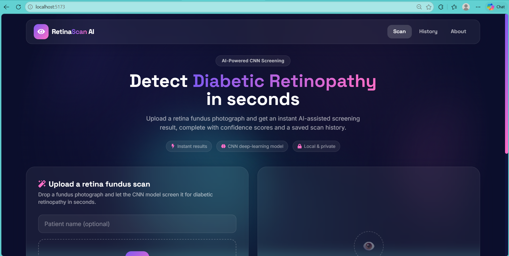
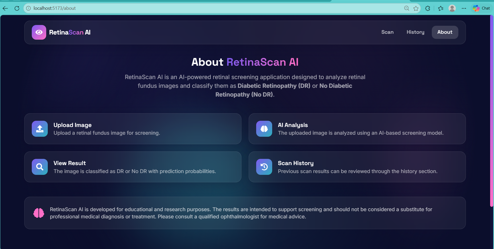
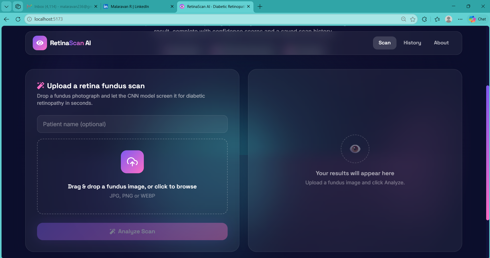
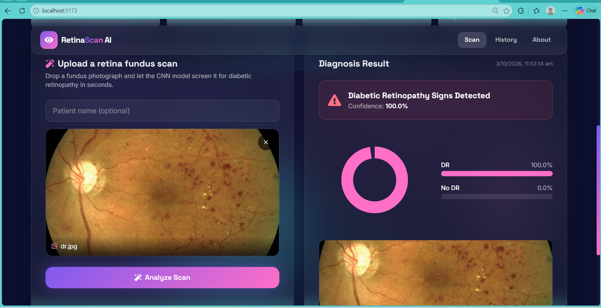
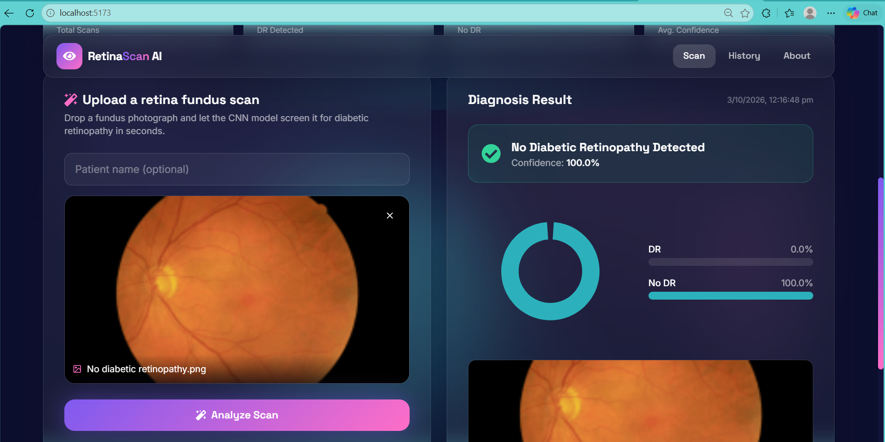

<<<<<<< HEAD
# 👁️ RetinaScan AI – Diabetic Retinopathy Detection

An AI-powered Full Stack Web Application that analyzes retinal fundus images and predicts Diabetic Retinopathy (DR) status using a CNN-based deep learning model.

RetinaScan AI provides an interactive dashboard to upload retinal images, view prediction results, analyze confidence scores, and track previous scans.

## 🚀 Features

- 🏠 **Interactive Dashboard** – Modern and responsive user interface.
- 📤 **Image Upload** – Upload retinal fundus images for analysis.
- 🧠 **AI-Based Detection** – CNN-powered image classification using TensorFlow/Keras.
- 📊 **Prediction Results** – Display DR / No DR predictions with confidence scores.
- 📈 **Analytics Dashboard** – Visualize scan statistics and prediction information.
- 📋 **Scan History** – View and search previously analyzed images.
- ℹ️ **About Page** – Information about the application and its purpose.

## 🛠️ Tech Stack

| Technology | Purpose |
|---|---|
| Python | Backend programming |
| Django 5 | Backend framework |
| Django REST Framework | REST API development |
| React.js | Frontend development |
| Vite | Frontend build tool |
| Tailwind CSS | UI styling |
| TensorFlow / Keras | Deep Learning model |
| SQLite | Database |
| Framer Motion | UI animations |
| Recharts | Dashboard visualizations |

## 📸 Application Screenshots

### 🏠 Home Page



### ℹ️ About Page



### 📤 Upload Page



### 🧠 DR Detection Output



### ✅ No DR Detection Output



## ⚙️ Installation & Setup

### 1. Clone Repository

```bash
git clone https://github.com/Malaravan236/Retina_Scan.git
```

### 2. Navigate to Project

```bash
cd Retina_Scan
```

### 3. Backend Setup (Django)

```bash
cd backend
python -m venv venv
```

Activate virtual environment:

**Windows:**

```bash
venv\Scripts\activate
```

Install dependencies:

```bash
pip install -r requirements.txt
```

Run migrations:

```bash
python manage.py migrate
```

Start Django server:

```bash
python manage.py runserver
```

Backend URL:

```text
http://127.0.0.1:8000/
```

### 4. Frontend Setup (React)

Open another terminal:

```bash
cd frontend
npm install
npm run dev
```

Frontend URL:

```text
http://localhost:5173/
```

**Note:** Keep both Django and React development servers running.

## 🔗 API Endpoints

| Method | Endpoint | Description |
|---|---|---|
| POST | `/api/predict/` | Upload image and predict |
| GET | `/api/history/` | Retrieve scan history |
| DELETE | `/api/history/<id>/` | Delete scan record |
| GET | `/api/stats/` | Dashboard statistics |
| GET | `/api/health/` | Model health status |

## 📂 Project Structure

```text
Retina_Scan/
│
├── backend/
│   ├── dr_backend/
│   ├── detector/
│   │   ├── ml_model/
│   │   ├── views.py
│   │   ├── serializers.py
│   │   └── ml_engine.py
│   └── requirements.txt
│
├── frontend/
│   ├── src/
│   │   ├── api/
│   │   ├── components/
│   │   └── pages/
│   └── package.json
│
├── screenshots/
│   ├── home-page.png
│   ├── about-page.png
│   ├── upload-page.png
│   ├── dr-output.png
│   └── no-dr-output.png
│
└── README.md
```

## 👨‍💻 Developer

**Malaravan R**

Python Full Stack Developer

- GitHub: https://github.com/Malaravan236
- LinkedIn: https://www.linkedin.com/in/malaravanr/
- Email: malaravan236@gmail.com

## ⚠️ Disclaimer

This project is developed for educational and portfolio purposes. It is not a clinically validated medical device and must not be used for actual medical diagnosis or treatment decisions. Always consult a qualified ophthalmologist for medical evaluation.

---

⭐ If you find this project interesting, feel free to explore the repository and give it a star!
=======
# Retina_Scan
>>>>>>> 1101bd9cf9daa6c2ae48a8f91d0c57269af0d1fa
